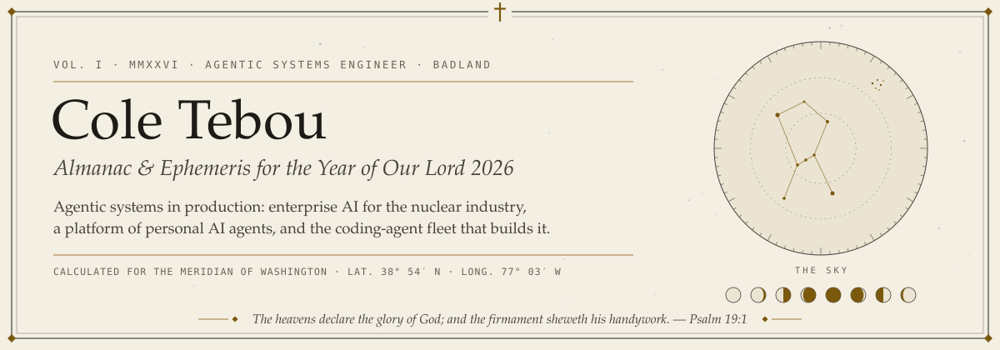
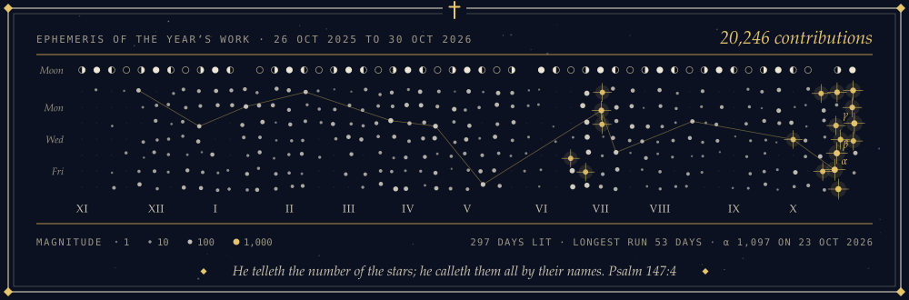
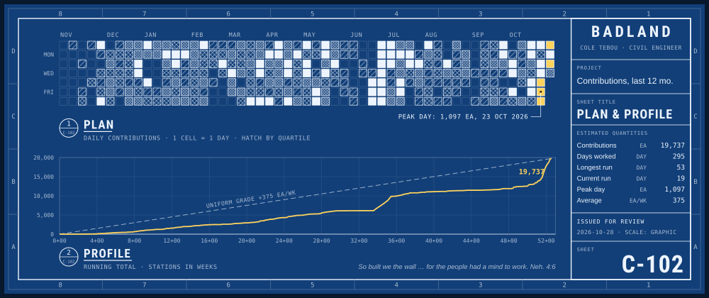

<a href="https://coletebou.com">
  <picture>
    <source media="(prefers-color-scheme: dark)" srcset="assets/banner-dark.svg">
    <source media="(prefers-color-scheme: light)" srcset="assets/banner-light.svg">
    
  </picture>
</a>

I build agentic AI for the nuclear industry: enterprise systems on AWS, where every result has to be
traceable.

Before code, I built things you can stand on. As a civil and structural engineer in heavy construction, I led
a 20-person ironworker crew setting six million pounds of rebar on a $100M ship-lift drydock. I bring that
discipline to agents.

I also founded **[Badland](https://badland.ai)**: personal AI agents you text over iMessage and SMS, each with
its own memory, skills and tools. More than a hundred live on a single server and wake when texted, and a
fleet of coding agents builds and runs it all, handing work to each other in chains thirty generations deep.
The stack behind that fleet is open source:

## The agent stack

<table>
<tr>
<td width="50%" valign="top">

### [Drover](https://github.com/coletebou/drover)

**The control plane.** Every Claude Code session, Codex thread and Grok bot on every host, in three
lanes: waiting on you, working, idle. A manager agent reads the board and keeps the fleet moving. Answer, message and launch them from a browser, a terminal, a
Mac, an iPhone, a watch or a browser extension. One daemon per machine, zero npm dependencies, no open
ports.

`Node 24` `Swift` `MCP` `tmux`

</td>
<td width="50%" valign="top">

### [badland-brain](https://github.com/coletebou/badland-brain)

**The shared memory.** One self-hosted memory for Claude Code, Codex, ChatGPT and any MCP client.
Hybrid keyword and vector search, facts that keep their history, per-agent keys, a write gate that
refuses secrets, and provenance on everything an agent reads back.

`TypeScript` `MCP` `SQLite FTS5 + sqlite-vec` `MongoDB`

</td>
</tr>
<tr>
<td width="50%" valign="top">

### [dx](https://github.com/coletebou/dx)

**The environment.** Dotfiles for running fleets of coding agents: Claude Code and Codex hooks, a
skills marketplace, tmux, git worktrees, session handoff chains and agent memory. macOS and Linux.

`zsh` `tmux` `Claude Code` `Codex`

</td>
<td width="50%" valign="top">

### [porchlight](https://github.com/coletebou/porchlight)

**The login screen.** A fleet-aware MOTD: vitals, services, AI agents and their plan limits,
containers, pull requests and cloud status, ranked into one attention list and rendered from cache in
milliseconds.

`Python 3.9+` `zero dependencies`

</td>
</tr>
</table>

## Sites

<table>
<tr><td><b><a href="https://agent.badland.ai">agent.badland.ai</a></b></td><td>Your own AI agent in iMessage and SMS. No new app: sign up and it texts you.</td></tr>
<tr><td><b><a href="https://chat.badland.ai">chat.badland.ai</a></b></td><td>Three AIs answer one prompt side by side, with image generation and voice.</td></tr>
<tr><td><b><a href="https://tallgrass.social">tallgrass.social</a></b></td><td>Go find something wild: identify what you find, keep your discoveries, explore with friends.</td></tr>
<tr><td><b><a href="https://starheart.ai">starheart.ai</a></b></td><td>Intelligence in service of the Creator: AI used to glorify God, a light in a dark world.</td></tr>
<tr><td><b><a href="https://sunnydayz.co">sunnydayz.co</a></b></td><td>Family outdoor gear for trading screen time for sunshine.</td></tr>
<tr><td><b><a href="https://arena.badland.ai">arena.badland.ai</a></b></td><td>ROOTFALL: a 3D AI battle royale you can watch live.</td></tr>
<tr><td><b><a href="https://coletebou.com">coletebou.com</a></b></td><td>Portfolio, in four editions: <a href="https://coletebou.com">almanac</a> · <a href="https://plans.coletebou.com">blueprint</a> · <a href="https://term.coletebou.com">shell</a> · <a href="https://coletebou.github.io">index</a></td></tr>
<tr><td><b><a href="https://nebulatio.com">nebulatio.com</a></b></td><td>Nebulatio Studio: web design and development.</td></tr>
</table>

## Upstream

Pull requests merged into other people's projects, as of October 2026: 72 to
[ooxml](https://github.com/ChristopherVR/ooxml) (the logic behind its Office viewers) and 10 across
[OpenClaw](https://github.com/openclaw)'s projects: 8 to [Clawpatch](https://github.com/openclaw/clawpatch),
and one each to [OpenClaw](https://github.com/openclaw/openclaw) itself and [imsg](https://github.com/openclaw/imsg).
[Every merged pull request](https://github.com/search?q=author%3Acoletebou+is%3Apr+is%3Amerged+-user%3Acoletebou+-org%3ABadland-AI&type=pullrequests).

## Contributions

The last twelve months, redrawn every night in the portfolio's almanac, blueprint and shell editions.

---

  <a href="https://www.linkedin.com/in/cole-tebou">LinkedIn</a> ·
  <a href="https://x.com/coletebou">X</a>

